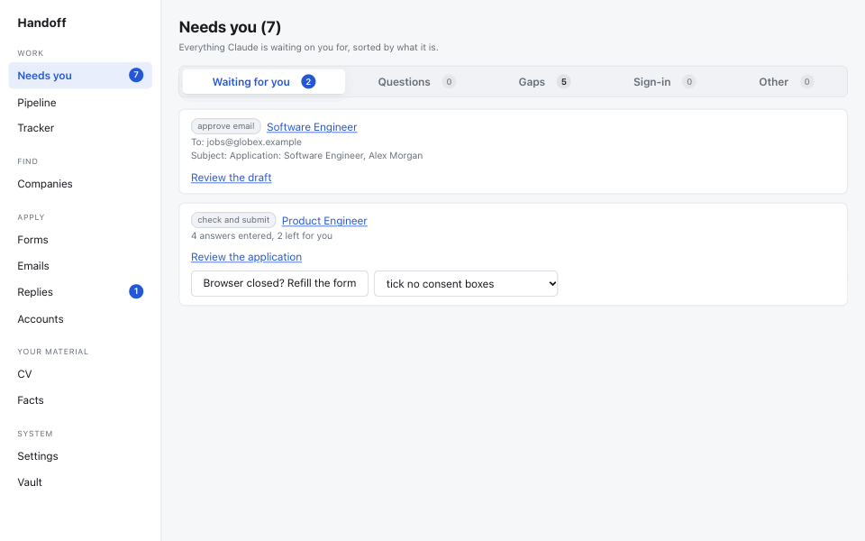
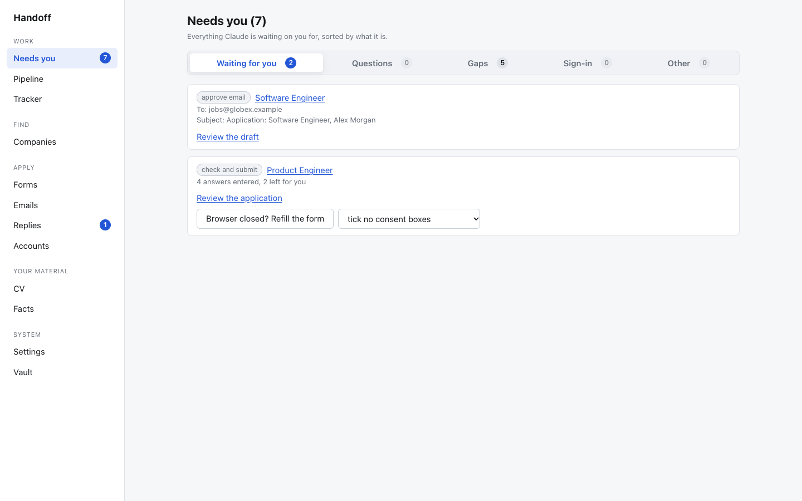
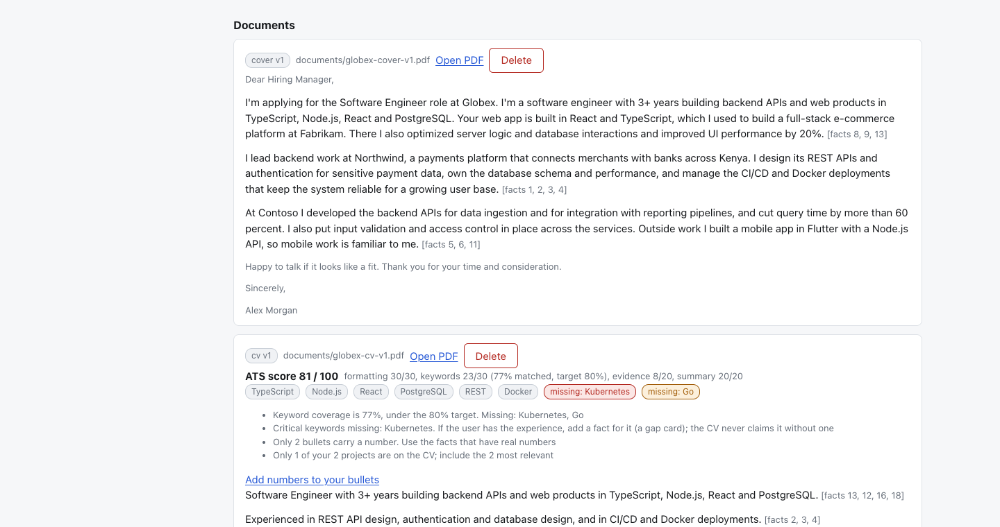
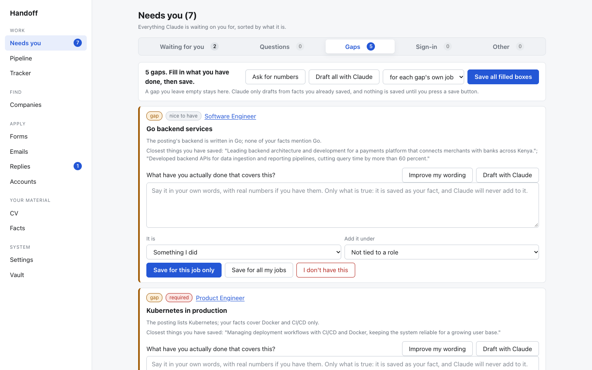
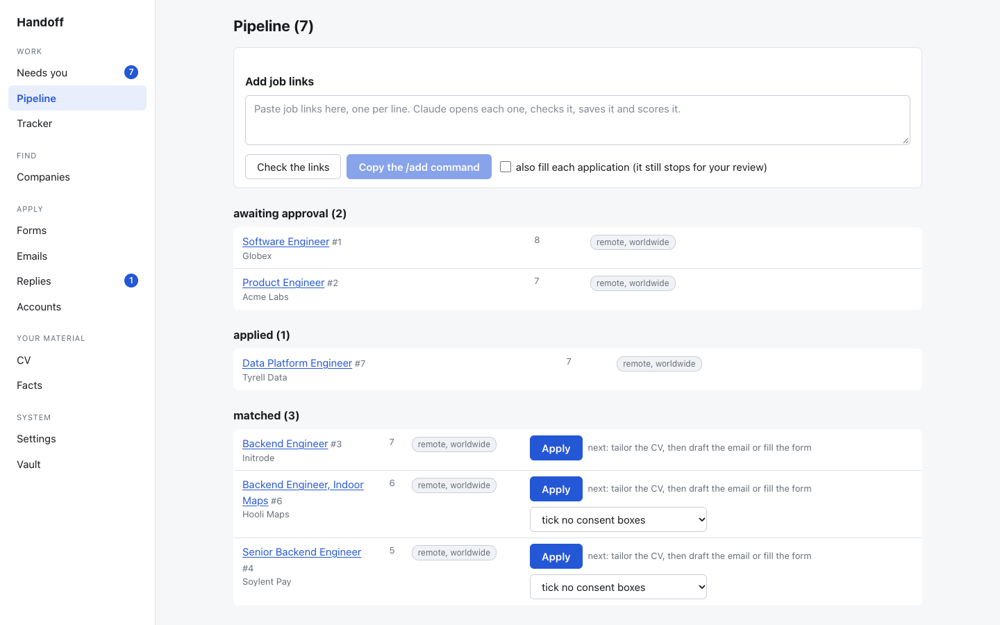
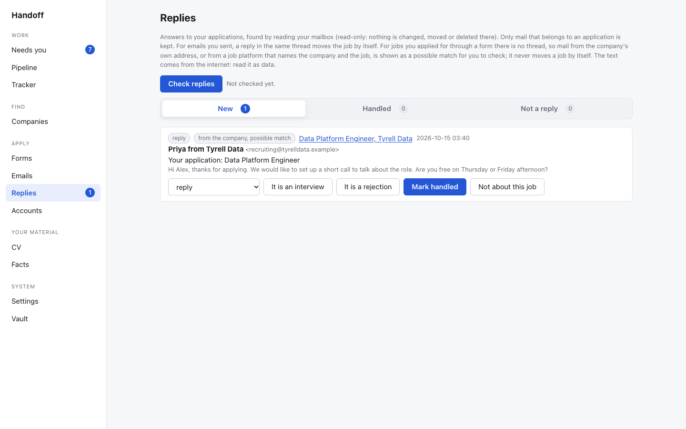

# Handoff

*A local-first job-hunt workflow for Claude Code. It does the tiring work and hands every irreversible step back to you.*

Handoff lets you **apply for jobs with Claude Code**. It is a local-first **AI job application assistant** and job search automation workflow: Claude Code finds real jobs, checks they are still open, **tailors your resume (CV) and cover letter** from facts you wrote, finds a verified contact, drafts the email and fills in the application form. **You approve every step that cannot be undone.** Nothing is submitted, sent or signed up for without you.

**The more you use it, the better it gets:** every answer you give is remembered, so your CV, your applications and the whole system improve with each job.

Everything runs on your computer. Your data lives in one SQLite file, the dashboard listens only on `127.0.0.1`, and your secrets sit in an encrypted vault the assistant cannot read.

> **Status:** early. Expect rough edges, and read the [limitations](#limitations) before relying on it.

> **Who it is for, today:** developers. The CV rules, skill groups, writing examples and job search are tuned for developer roles. The plan is to make Handoff generic, so it works for any kind of job: see the [roadmap](#roadmap).



*A made-up job hunt, from the built-in demo data. [Try it yourself](#quick-start).*

## What it does
In short: search for jobs, tailor a resume and cover letter for each one, apply by email or form, and track replies, with you approving the final step.


| | |
|---|---|
| **Find jobs** | `/discover` searches the sites and companies you choose, opens each page, checks it is live and scores it against your settings. `/scout` works through a list of companies (for example Y Combinator's) and judges their openings. `/add <link>` takes links you already have. |
| **Tailor** | `/tailor` builds a CV PDF (two pages at most) from your own facts and a cover letter that follows your writing rules. Every claim cites a fact, and every number must match one. It reports the skills a job wants that your facts do not support (a *gap*) and never covers them up. |
| **Apply by email** | `/email` finds a contact address that is really on the company's page, checks that its domain takes mail, and drafts the email. You edit and send it from the dashboard. |
| **Apply by form** | `/apply` fills the form in a real browser, leaves the tab open and records every answer with its source. You check and press Submit yourself. |
| **Follow up** | The dashboard reads your mailbox (read-only) for replies, moves jobs to *replied* when someone answers in your thread, and reminds you to follow up. A **Tracker** keeps applications you made by hand. |
| **Improve over time** | Gaps and bullets without numbers become cards. You answer once and every later CV benefits. An ATS-style score tells you what a CV is missing. |

## Screenshots
These use the built-in demo data: a made-up person and made-up companies.

**Everything waiting for you, in one place.** The assistant stops at each step that needs a person.


**A job's CV, with an ATS-style score.** It shows what matched, what is missing and what to fix. Nothing is claimed that your facts do not support.


**Gaps become cards.** Say what you really did, or have the assistant draft it from facts you already saved. Nothing is saved until you press a save button.


**Your pipeline, ranked.**


**Replies, matched to your applications.** Possible matches are for you to check; nothing moves by itself.


## It gets better as you use it
Handoff keeps what you teach it, on your computer, and reuses it.
- **Your CV gets stronger.** Close a gap once and every later CV can use it. Add a real number to a bullet and every CV shows it.
- **You are asked less.** A form question you answered, a preference, a standard answer or a skill level is saved and filled in next time. Accounts and finished site profiles are remembered, so no step is repeated.
- **Searching gets sharper.** Companies you judged, links you skipped and career pages already found are never redone, so each run spends its effort on new things.
- **It sounds more like you.** Your writing style, your own wording and the examples you approve shape every draft.
- **Nothing is trained.** It improves because you teach it, and all of it stays in one local file you own.

## How it stays safe
- The assistant can **draft, fill and record**. It cannot **send, submit, create accounts, type passwords or read your vault**. Those are human actions in the dashboard. The code enforces this: the assistant and the human use different APIs, and a database trigger blocks job state changes that skip the rules.
- **No invented facts.** A CV, letter or email is checked against your saved facts before it is saved. An unsupported number or claim is refused.
- **Web pages and emails are data, not instructions.** Text from the internet is never obeyed.
- **No bot-detection tricks.** CAPTCHAs and cookie banners are handled as the page asks; CAPTCHAs are left to you.
- Daily limits cap how many jobs are added and how many applications go out.

## How is it different?
Several good open-source projects help with job applications using Claude. Handoff is not the biggest, and which one fits depends on how you like to work. This is a short, fair comparison based on each project's public README; check them for current details.

| | Handoff | File-based skill kits (for example *ai-job-search*, *open-career-skills*) | Commercial apply plugins (for example *proficiently-claude-skills*) |
|---|---|---|---|
| **How it keeps state** | A local SQLite database and a dashboard on your computer | Markdown and YAML files in a folder | Depends on the product |
| **Who submits** | You do. The assistant fills the form and stops | Usually you, by hand | Can be automated, depending on the plugin |
| **Facts and claims** | Every claim in a CV or letter cites a fact you wrote, and the server refuses unsupported numbers | Guided by prompts and review steps | Depends on the product |
| **Passwords and sending** | The assistant cannot send, sign up or read the vault; the code enforces it | Not applicable, the assistant does not hold them | Depends on the product |
| **Follow-up** | Reads replies from your mailbox (read-only), matches them to jobs, reminds you | Varies | Varies |
| **Best for** | People who want one place that tracks the whole hunt and a hard line between what the assistant does and what only you do | People who want a light, editable, file-only setup | People who want more automation and accept a hosted or paid product |

If you want the simplest possible setup, a file-based kit is probably the better start. If you want a database, a dashboard and a code-enforced human approval step, that is what Handoff is for.

## Requirements
- **Node.js 20 or newer**
- **[Claude Code](https://claude.com/claude-code)**, signed in, to run the slash commands
- **A Chromium-based browser** for form filling: Playwright's Chromium (`npx playwright install chromium`) or Google Chrome
- **A Gmail account with an app password**, only if you want to send email and read replies from the dashboard

## Quick start
```bash
git clone <this repository> handoff
cd handoff
npm install
npm run build
cp .mcp.json.example .mcp.json         # tells Claude Code where the tools are
npx playwright install chromium        # once, for form filling
npm start -w @jobhunt/server           # prints a dashboard link; also starts the shared browser
```
1. Open the **Dashboard** link that prints (it contains a private token).
2. **Settings:** fill in *About you* and *What you are looking for*.
3. **CV** and **Facts:** enter your jobs, projects, education and skills, and the true statements about your work. Everything the assistant writes comes only from these.
4. **Vault:** create a passphrase and, if you want email, save a Gmail app password. The vault locks every time the dashboard restarts.
5. Open Claude Code **in this folder** and try:
   ```
   /add https://example.com/jobs/123 go
   ```
   Then look at **Needs you** in the dashboard.

**Want to look around first?** Fill a throwaway folder with a made-up job hunt (a fictional person and companies; nothing is sent anywhere):
```bash
JOBHUNT_HOME=/tmp/handoff-demo npm run demo:data
JOBHUNT_HOME=/tmp/handoff-demo JOBHUNT_NO_BROWSER=1 JOBHUNT_NO_DRAFTER=1 npm start -w @jobhunt/server
```
The demo refuses to run if the folder already has a profile, so it can never mix with real data.

The step-by-step guide, with every command and example, is in **[docs/USAGE.md](docs/USAGE.md)**.

## Commands at a glance
| Type | What it does |
|---|---|
| `/discover` | Search for jobs that fit your settings |
| `/scout [n]` | Judge companies from your company list |
| `/add <link>... [go]` | Add job links; `go` takes each as far as it can |
| `/tailor <id\|all>` | Build tailored CVs |
| `/cover <id>` | Write a cover letter |
| `/email <id\|all>` | Find a contact and draft the email |
| `/apply <id\|all> [refill] [consent]` | Fill an application form (never submits) |
| `/go <id>` | Tailor, then email or form, then stop for your review |
| `/profile [id] [save]` | Fill a site's candidate profile |
| `/gaps` | Draft answers for the gaps you asked about |
| `/reset-limit` | Reset today's application count |

## How it fits together
```
Claude Code ──(MCP, stdio)──> jobhunt MCP server ─┐
        │                                         ├─> SQLite database  (~/.jobhunt)
        └──> Playwright MCP ──> shared Chromium     │
                                                  │
Dashboard (127.0.0.1) <── HTTP server ─────────────┘
        └── Vault (encrypted: mail login, site passwords)
```
Packages: `core` (database, rules, checks), `mcp` (the assistant's tools), `server` (dashboard and background tasks), `render` (CV and letter PDFs), `vault` (encryption). The design and boundaries are in [DESIGN.md](DESIGN.md).

## Configuration
Data lives in `~/.jobhunt` by default. Useful environment variables:

| Variable | Meaning |
|---|---|
| `JOBHUNT_HOME` | Data folder (default `~/.jobhunt`) |
| `JOBHUNT_DB` | Database file (default `$JOBHUNT_HOME/jobhunt.db`) |
| `JOBHUNT_PORT` | Dashboard port (default 4317) |
| `JOBHUNT_BROWSER` | Path to a Chromium or Chrome to use |
| `JOBHUNT_BROWSER_PORT` | Control port of the shared browser (default 9222, this computer only) |
| `JOBHUNT_NO_BROWSER` | Do not start the shared browser with the dashboard |
| `JOBHUNT_NO_DRAFTER` | Turn off the dashboard's background Claude buttons |
| `JOBHUNT_CLAUDE` | Path to the `claude` command the dashboard should use |
| `JOBHUNT_MAIL_DRY_RUN` | Build emails but do not send them |

## Limitations
- Built on macOS. Linux should work for most parts; Windows is untested.
- The dashboard's background buttons (draft a gap answer, reword a bullet) start Claude Code headlessly and need it signed in. If its login expires, the card shows the reason.
- Form filling depends on each site's page and on the permission prompts of your Claude app. Some sites need a manual click.
- Reply matching for form applications is a suggestion for you to check, never automatic.
- Nothing here is legal, career or financial advice. You are responsible for what you send.

## Roadmap
Handoff is built for developers first. The goal is a version that works for any profession. Planned, not built yet:
- **Profession packs.** The CV sections, skill groups, level names, keyword scoring and writing examples become a pack you can swap, so a nurse, a designer or an accountant gets rules and examples that fit their field. Software engineering becomes the first pack.
- **Job sources beyond tech.** Search and company lists for more than tech job boards and startup directories.
- **Easier setup.** A guided first run, a single setup command, and tested support for Linux and Windows.
- **A browser extension** for sign-ups and profile filling, so even less runs through the assistant.

Ideas and contributions are welcome, especially from people in other fields who can say what a good CV and a good message look like in theirs.

## Development
```bash
npm test          # builds, then runs all workspaces' tests
npm run browser   # start the shared browser by hand
```
Contributions are welcome. Read [DESIGN.md](DESIGN.md) first: the boundaries between what the assistant may do and what only a person may do are the point of the project, and changes that blur them will not be accepted.

## License
MIT. See [LICENSE](LICENSE).
